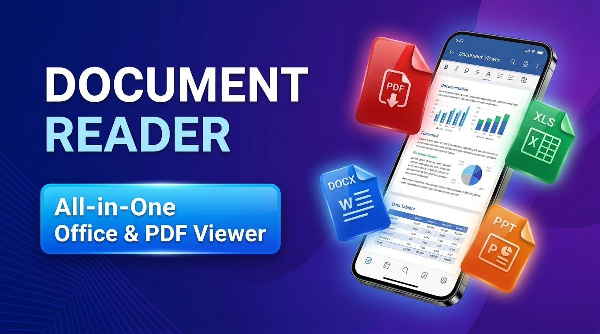
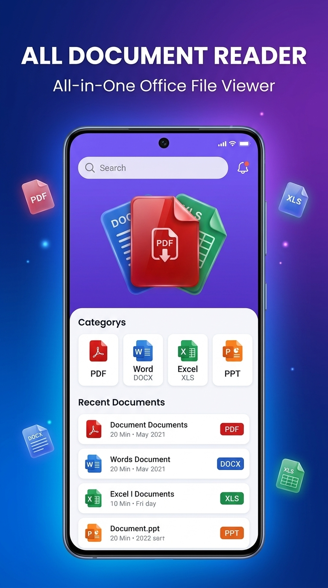
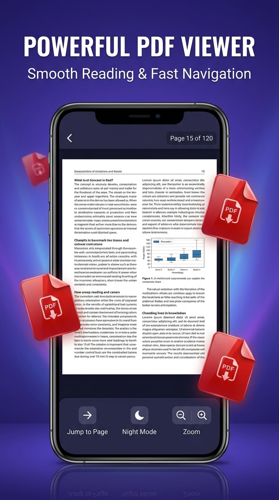
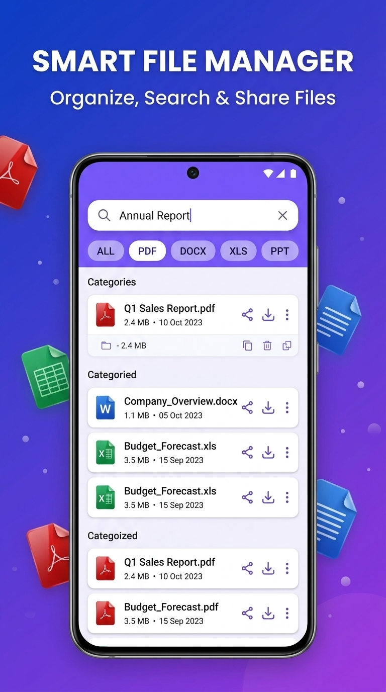

# Play Store Promotional Assets: Document Reader & PDF Viewer

Play Store listing ke liye **3 High-Converting Screenshots (9:16)** aur **1 Feature Graphic (16:9)** create kar diye gaye hain. Yeh assets app ki original theme (Purple, Blue, Red) aur app icon branding ke sath perfectly aligned hain.

---

## 1. Feature Graphic (Google Play Store Banner)
- **Ratio**: 16:9 (Ideal for Play Store 1024x500 banner)
- **Key Message**: *DOCUMENT READER — All-in-One Office & PDF Viewer*
- **Elements**: 3D glossy format badges (PDF, DOCX, XLS, PPT), modern preview phone, dynamic lighting.

---

## 2. App Screenshots (Phone Display - 9:16)

### Screenshot 1: All Document Reader (Dashboard)
- **Header**: `ALL DOCUMENT READER — All-in-One Office File Viewer`
- **Features Highlighted**: Category cards for PDF, Word, Excel, PPT, search bar, and recent files list.

---

### Screenshot 2: Powerful PDF Viewer
- **Header**: `POWERFUL PDF VIEWER — Smooth Reading & Fast Navigation`
- **Features Highlighted**: PDF document view, page navigation, Jump to Page, Night Mode, and Zoom tools.

---

### Screenshot 3: Smart File Manager
- **Header**: `SMART FILE MANAGER — Organize, Search & Share Files`
- **Features Highlighted**: Format filter tabs (All, PDF, DOCX, XLS, PPT), search filtering, file sizes, and quick actions.

---

## Google Play Store Guidelines Check
| Asset | Recommended Dimension | Aspect Ratio | Status |
| :--- | :--- | :--- | :--- |
| **Feature Graphic** | 1024 x 500 px | ~16:9 | Ready |
| **Screenshot 1** | 1080 x 1920 px (or similar) | 9:16 | Ready |
| **Screenshot 2** | 1080 x 1920 px (or similar) | 9:16 | Ready |
| **Screenshot 3** | 1080 x 1920 px (or similar) | 9:16 | Ready |
